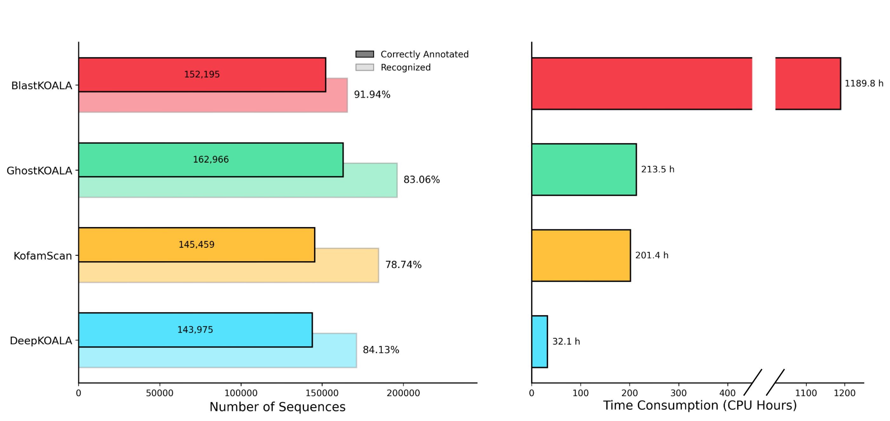
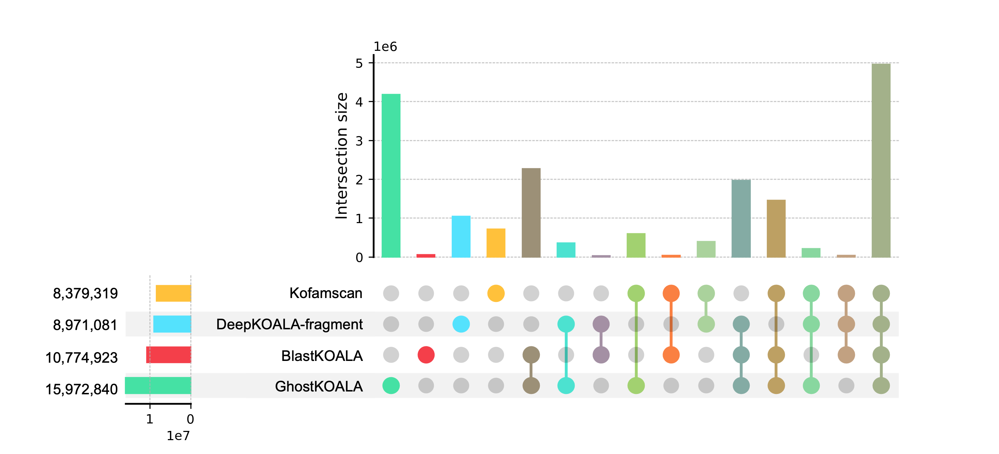

# DeepKOALA
### Beta Version
**An ultra-fast and accurate tool for KEGG Orthology (KO) assignment, powered by deep learning.**

**Online version: https://www.genome.jp/tools/deepkoala/**

**Paper: https://doi.org/10.1093/bib/bbag445**

### Table of Contents
* [About the Project](#about-the-project)
* [Performance](#performance)
* [Installation](#installation)
* [Usage](#usage)
* [How to Cite](#how-to-cite)
* [License](#license)

## About the Project
**DeepKOALA** is a high-performance deep learning-based tool for rapid protein function annotation according to the **KEGG Orthology (KO)** system. By framing KO assignment as an open-set recognition problem, it can effectively distinguish between known and unknown functional sequences, thereby reducing false-positive annotations.

Built on a Gated Recurrent Unit (GRU) architecture, the tool provides excellent computational efficiency while ensuring high accuracy. In this beta version, DeepKOALA offers two operational models:

* **`full` model**: Delivers high-precision annotation for complete protein sequences.
* **`fragment` model**: Specially optimized for handling fragmented sequences common in metagenomic data, significantly improving the recognition rate and accuracy for incomplete sequences.


## Performance

### Comparison with Mainstream Tools



On an independent test set, DeepKOALA is up to **37.5 times faster** than BlastKOALA while maintaining a comparable or superior precision (84.13%) to tools like KofamScan (78.74%) and GhostKOALA (83.06%).

### Application on Metagenomic Datasets



**`fragment` model** is optimized for fragmented sequences. It can annotate the 46 million proteins of the OM-RGC v2 catalog in approximately 30 minutes and additionally identifies over 1 million sequences missed by other mainstream tools.


## Installation

### Prerequisites
- [x] Git
- [x] Python = 3.11
- [x] (For GPU users) NVIDIA graphics driver


### 1. Clone the Repository

First, clone the source code from GitHub to your local machine and navigate into the project directory.

```bash
git clone https://github.com/zhaoxi120/deepkoala
cd deepkoala
```

### 2. Create and Activate the Virtual Environment

Create an independent Python virtual environment named deepkoala_env inside the project directory.

For MacOS/Linux users:
```bash
python3 -m venv deepkoala_env
source deepkoala_env/bin/activate
```

For Windows users:
```bash
python3 -m venv deepkoala_env
.\deepkoala_env\Scripts\activate
```

After activation, you will see (deepkoala_env) at the beginning of your terminal prompt.


### 3. Install Dependencies

We use the `requirements.txt` file to manage most of the project's dependencies. Run the following command to install them:
```bash
pip install -r requirements.txt
```

> [!WARNING]
> **For GPU Users (Manual PyTorch Installation Required):**
> 1. Prepare the dependency file. Open `requirements.txt`, comment out the line for `torch` by adding a `#` at the beginning, and save the file.
> ```txt
> numpy==1.26.3
> pandas==2.2.2
> # torch==2.4.1
> tqdm==4.66.4
> ```
> 2. Install all other dependencies by running the following command:
> ```bash
> pip install -r requirements.txt
> ```
> 3. Check your system's GPU compatibility. Run `nvidia-smi` to find the maximum CUDA Version your driver supports.
> 4. Finally, install a compatible PyTorch version. Visit the [Official PyTorch Website](https://pytorch.org/), find the command for a CUDA version that is less than or equal to your driver's, and run it. For example, install PyTorch 2.4.1 with GPU Support:
> ```bash
> pip install torch==2.4.1 --index-url https://download.pytorch.org/whl/cu121
> ```
>
> **For Apple Silicon Users:** install a macOS PyTorch build with MPS support. DeepKOALA can automatically detect MPS with `--device auto` (the default), or you can explicitly select it with `--device mps`.

### 4. Download Pre-trained Models

The pre-trained model file (version February 2025) is already included in this beta version of the project.

Updated models are released at [GenomeNet](https://www.genome.jp/ftp/db/deepkoala/). Please download the files from this site and place them into the `resources` directory. The program will automatically detect and use the latest version.

## Usage

### Basic Usage

The primary way to use DeepKOALA is via its command-line interface.

```bash
python3 -m deepkoala.cli -i <input.fasta> -o <results.csv> [OPTIONS]
```

### Example

To annotate a set of proteins using the default settings:

```bash
python3 -m deepkoala.cli -i my_proteins.fasta -o results.csv
```

To annotate metagenomic genes using the specialized model and get a detailed output:

```bash
python3 -m deepkoala.cli -i metagenome.fasta -o detailed_results.csv --model frag --detail
```

On an Apple Silicon Mac with an MPS-enabled PyTorch build, you can explicitly run inference on the Apple GPU:

```bash
python3 -m deepkoala.cli -i my_proteins.fasta -o results.csv --device mps
```

### Streaming large FASTA files

Standard single-model inference streams FASTA records and writes predictions one
batch/window at a time, preserving input order (including duplicate identifiers),
KO thresholds, and CSV columns. CPU, MPS, and `--memory-preset off` use fixed-size
batches; their `--num_workers` option controls tokenization workers with bounded
prefetching. CUDA defaults to the adaptive policy described below. RAM use depends
on the window, batches, sequence lengths, workers, and `--topk`, rather than the
total number of records.

All readers use the first whitespace-delimited token after `>` as the sequence
identifier. Spaces and tabs separate the ID from its description; for example,
`>seq1<TAB>description` produces `seq1` in both standard and multi-domain mode.
Older standard-mode results could include tab-separated descriptions in the ID.

Results are written to a temporary file beside the destination and published only
after inference succeeds. A failed run preserves an existing destination. Plain
CSV and compressed outputs such as `results.csv.gz` are supported; TAR output
also needs temporary disk space for the uncompressed CSV. The progress display
shows completed batches (fixed mode) or windows (adaptive mode), without a full
FASTA pre-scan.

This integrates the streaming I/O approach proposed in
[issue #15](https://github.com/zhaoxi120/deepkoala/issues/15). Partitioned output
and checkpoint resumption from its attached runner are not enabled here.
Multi-domain mode retains its existing implementation.
The indexable `ProteinDataset` API also remains eager; use `get_dataloader` or
`inference` for streaming.

### Automatic CUDA batches and memory presets

Ordinary CUDA commands automatically select one of seven presets from the
device's total visible memory. No manual length sorting or separate run for
sequences above 2048 aa is required. Each window contains at most 4096 records,
without a cumulative residue limit or sequence truncation. Host memory depends
on their total length: 4096 sequences of 16384 aa contain 64 MiB of raw ASCII
sequence data, in addition to Python objects, results, model and batch tensors.
Within the window, sequences are sorted by length to reduce padding, then the
original order is restored before writing. Adaptive mode tokenizes each batch
in the reader process; `--num_workers` applies only to fixed mode.

| Preset (`--memory-preset`) | Nominal capacity (GiB) | 80% total budget (GiB) |
| --- | ---: | ---: |
| `2` | 2 | 1.6 |
| `4` | 4 | 3.2 |
| `8` | 8 | 6.4 |
| `16` | 16 | 12.8 |
| `24` | 24 | 19.2 |
| `32` | 32 | 25.6 |
| `gt32` | 64 | 51.2 |

The `gt32` budget is twice the `32` budget. The effective budget is the minimum
of the preset budget, 80% of actual device capacity, and the process's reusable
allocator reservation plus 80% of free memory measured at initialization. Thus a 40 GiB device
uses at most a 32 GiB scheduling budget, even with `gt32`. Automatic selection
allows a 5% shortfall for nominal capacities; above 32 GiB it selects `gt32`.

This is an **upper scheduling target, not a request to fill VRAM or a hard
allocator cap**. It includes a conservative 0.75 GiB allowance for CUDA context
and libraries. Three small inference probes measure memory cost using the loaded
model; extra margins cover padding and classifier outputs. The allocator target
includes already-live tensors and model weights. CUDA/cuDNN workspace choices,
other processes, and different hardware can still cause OOM. The Python API
does not change the caller's process-wide CUDA allocator limit.

On CUDA OOM the failed tensors are released, the batch is split, and the budget
for later batches is reduced. This does not step down through the named presets:
for a failed batch with `B` sequences and maximum length `L`, the padded-residue
limit becomes at most `floor(B * L / 2)`, and the records are split in half for
retry. The reduced limit persists for the rest of the run; it is not automatically
raised again. Shorter sequences can still form larger batches within that limit.
A single sequence that still cannot fit produces
an actionable error; `--oom-fallback cpu` instead processes it on CPU and reports
the fallback. Sequences are never truncated or silently skipped. CPU fallback
may be slow and still needs sufficient host RAM. Sorting/regrouping can produce
small floating-point differences; use `--memory-preset off` for the original
fixed batching behavior.

```bash
# Automatic preset, with CPU fallback for individual oversized sequences
python3 -m deepkoala.cli -i proteins.fasta -o results.csv --oom-fallback cpu

# Optional conservative override; explicit batch size remains an upper limit
python3 -m deepkoala.cli -i proteins.fasta -o results.csv --device cuda \
  --memory-preset 8 --batch_size 128

# Original fixed-size streaming behavior
python3 -m deepkoala.cli -i proteins.fasta -o results.csv --memory-preset off -bs 32
```

See [A100 validation results](docs/gpu-presets-validation.md) for all seven memory
budgets, real OOM recovery tests, numerical differences, and hardware limitations.
The [current performance comparison](docs/performance-comparison.md) reports
timing and memory after removing the window residue limit: mixed-length inference
improved in the measured case, while complete CLI runtime was similar and long
equal-length sequences did not become faster. See [usage compatibility](docs/usage-compatibility.md)
for unchanged commands and the differences in CUDA defaults and detailed predictions.

[GitHub CI](docs/testing.md#github-actions) checks lightweight CPU compatibility
on Linux, Windows and macOS using small synthetic models. Large-input timing,
VRAM stress and real GPU recovery tests are local validation only; their inputs
and raw results are not CI dependencies or uploaded artifacts.

### Command-Line Options

* `--input_path` `-i`: Path to the input protein FASTA file. **(Required)**
* `--output_path` `-o`: Path for the output CSV results file. **(Required)**
* `--model` `-m`: Sets the prediction model. (Default: `full`)
  * `full`: Standard model, optimized for complete protein sequences.
  * `frag`: Specialized model, trained to better handle fragmented sequences common in metagenomics.
* `--date` `-d`: Specifies the version of the pre-trained model to use. (Default: `latest`, which loads the latest available model).
* `--batch_size` `-bs`: Maximum sequences per batch. Default: `512` for adaptive CUDA, `32` for fixed CLI batches. Explicit values remain ceilings in adaptive mode.
* `--num_workers` `-nw`: Tokenization workers for fixed batches (default `2`); adaptive mode uses its reader process.
* `--memory-preset`: `auto` (default), `off`, `2`, `4`, `8`, `16`, `24`, `32`, or `gt32`. Explicit capacity presets require CUDA and standard single-model mode.
* `--sort-window`: Maximum records per sorting window (default `4096`, adaptive mode).
* `--max-padded-residues`: Optional lower ceiling on batch size times maximum sequence length; cannot increase the measured budget.
* `--oom-fallback`: `error` (default) or `cpu` for single sequences that cannot fit adaptive CUDA batches. OOM batch splitting is automatic.
* `--device`: Selects the inference device: `auto`, `cpu`, `cuda`, or `mps`. The default `auto` mode prefers CUDA, then Apple Silicon MPS, and finally CPU. Explicitly requested unavailable backends produce an error instead of silently falling back.
* `--detail`: Emit a detailed output format instead of the simple default.
  * **Default (simple)**: A concise format that only shows the predicted KO label (`predict_label`) for sequences that meet the confidence threshold. Other predictions are left blank.

       | name                     | predict_label |
       | :---:                    | :---:         |
       | T04784_FRACYDRAFT_201661 | K25156        |
       | T04784_FRACYDRAFT_233513 |               |

  * **With `--detail`**: A comprehensive format that shows the top prediction for every sequence, its probability score, the required confidence threshold, and an asterisk (`*`) in the `annotate` column if the prediction is confident (`probability` >= `threshold`).

       | name                     | predict_label | probability | threshold | annotate |
       | :---:                    | :---:         | :---:       | :---:     | :---:    |
       | T04784_FRACYDRAFT_201661 | K25156        | 0.999643    | 0.659121  | *        |
       | T04784_FRACYDRAFT_233513 | K15259        | 0.689804    | 0.921019  |          |

   * **With `--detail` and `--multi` enabled**: Displays the start and end positions of each domain (the first-ranked hit includes boundary searches; other ranked hits leave `start`/`end` empty).

       | name                            | predict_label | probability | threshold | start | end  | annotate |
       | :---:                           | :---:         | :---:       | :---:     | :---: | :---:| :---:    |
       | Caldivirga_maquilingensis_A1_A2 | K03041        | 0.742483    | 0.61305   | 15    | 902  | *        |
       | Caldivirga_maquilingensis_A1_A2 | K03042        | 0.999944    | 0.882147  | 910   | 1275 | *        |

* `--multi`: Enables an optional multi-domain validation mode that uses profile HMMs to precisely define the boundaries of each domain (disabled by default).
* `--profiles_dir` `-pd`: Provides the directory containing the required HMM profiles when multi-domain mode is enabled.
* `--topk` `-tk`: Emit the top **k** predictions per input sequence (Default: `1`).


> [!WARNING]
> **For Multi-domain Mode Users:**
> 1. Please install [HMMER](http://hmmer.org/) and confirm that `hmmsearch` can be run from the command line.
> 2. Download `profiles.tar.gz` from [KOfam](https://www.genome.jp/ftp/db/kofam/archives/2025-02-01/) and extract it.
> 3. Pass the extracted folder to `--profiles_dir` when running multi-domain mode:
> ```bash
> python -m deepkoala.cli -i proteins.fasta -o domains.csv \
>   --multi --profiles_dir "/path/to/profiles" --detail
> ```

### Python API

DeepKOALA can also be called programmatically when you want to integrate KO assignment inside a larger Python workflow.
With the source checkout on Python's import path, weights and KO configuration files are located in
`resources/YYYYMM/` alongside the `deepkoala/` directory, independently of the working directory.
The current wheel does not bundle those resources; see the [source-checkout resource requirements](docs/testing.md#existing-script-constraints).

```python
from deepkoala.infer import inference
from deepkoala.infer_multi import annotate_precision

# Simple single-model prediction written to CSV
stats = inference(
    input_path="input.fasta",
    output_path="results.csv",
    model="full",        # or "frag"
    topk=3,               # emit top-3 predictions per sequence
    detail=True,          # include probabilities and thresholds
)

# Multi-domain mode for a single sequence (requires HMM profiles)
hits = annotate_precision(
    sequence="MKTAYIAKQRQISFVKSHFSRQLEERLGLIEVQLR",
    hmmer_dir="/path/to/profiles",
    model="full",
)
```

* `deepkoala.infer.inference` mirrors the CLI options, using underscores in Python (`memory_preset`, `sort_window`, `max_padded_residues`, `oom_fallback`). `batch_size=None` selects `512` for adaptive CUDA or the original API default of `64` in fixed mode. It writes to `output_path` and returns total/annotated counts; adaptive runs also return a `batching` dictionary with the selected budget, measured peaks, OOM retries, and CPU fallbacks.
* `deepkoala.infer_multi.annotate_precision` returns a list of domain hits for a single sequence, each including the KO, probability, threshold, and domain boundaries when available.

## Citation

If you use DeepKOALA in your work, please cite:

```
@article{deepkoala2026,
  title = {DeepKOALA: a scalable deep learning framework for KEGG Orthology assignment},
  author = {Zhaoxi, Yu and Lingjie, Meng and Canh Hao, Nguyen and Hiroshi, Mamitsuka and Minoru, Kanehisa and Hiroyuki Ogata},
  year = {2026},
  journal = {Briefings in Bioinformatics},
  doi = {10.1093/bib/bbag445}，
  url = {https://doi.org/10.1093/bib/bbag445},
}
```

## License

This software is released under the [MIT License](./LICENSE).
